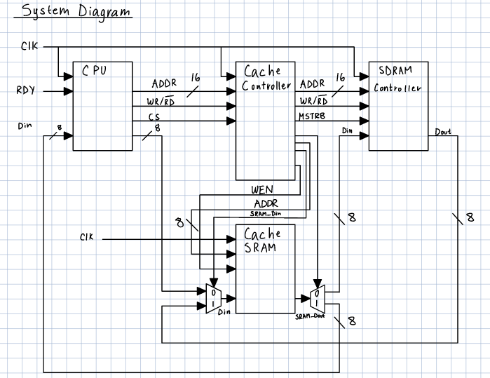
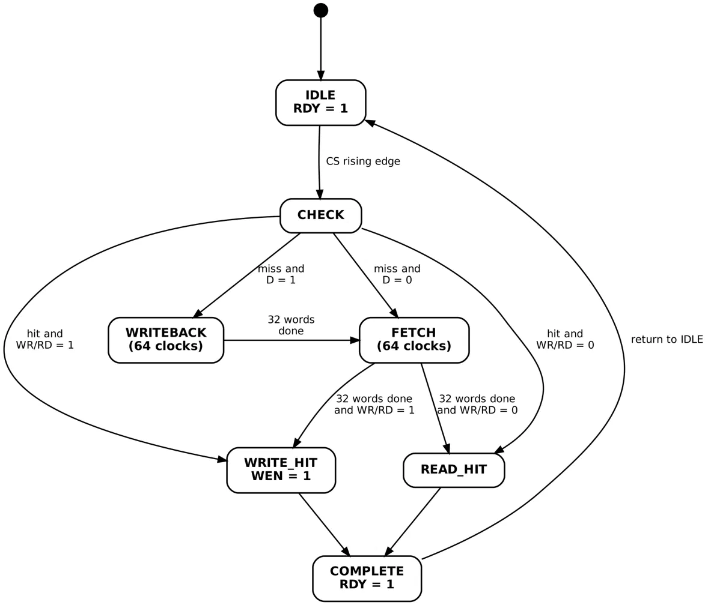
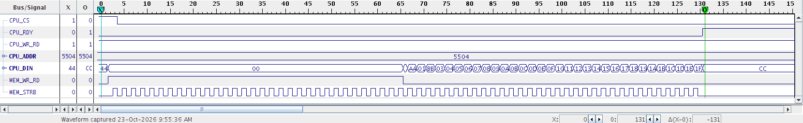

# FPGA Cache Controller in VHDL

A direct-mapped, write-back cache controller for a simple memory hierarchy, built in VHDL on a Xilinx Spartan-3E FPGA. It sits between a CPU request generator, a 256-byte BlockRAM cache and an SDRAM main-memory model, and it handles all four hit and miss cases. ChipScope captures from the real board verify the timing.

Built for **COE 758 (Digital Systems Engineering)** at Toronto Metropolitan University, Fall 2026.



## Features

- **Direct-mapped cache:** 256 bytes, organised as 8 blocks of 32 one-byte words
- **16-bit address:** tag `[15:8]`, index `[7:5]`, offset `[4:0]`
- **Write-back with write-allocate:** each block has a valid bit and a dirty bit
- **All four cases handled:** read hit, write hit, clean miss (fetch), and dirty miss (write-back, then fetch)
- **32-word block transfers:** two clocks per word, using `MEMSTRB`
- **On-board verification:** a ChipScope ICON and ILA capture every transaction over JTAG

## Architecture

| Module | File | What it does |
|---|---|---|
| Top level | `src/cache_system.vhd` | Connects the CPU, the cache wrapper, main memory and ChipScope |
| CPU generator | `src/CPU_gen.vhd` | Plays back 8 test transactions that cover every case, one per button press |
| Cache wrapper | `src/cache_wrapper.vhd` | Cache controller, cache SRAM and the data multiplexers |
| Cache controller | `src/cache_controller.vhd` | Address register, tag compare, tag/valid/dirty storage, block counter and FSM |
| Cache SRAM | `src/cache_SRAM.vhd` | 8 x 32-byte BlockRAM data storage |
| SDRAM controller | `src/DRAM_controller.vhd` | Behavioural main memory model |
| Debounce | `src/debounce.vhd` | Cleans up the trigger push button |

### Controller FSM

`IDLE → CHECK → READ_HIT / WRITE_HIT`, or on a miss `CHECK → (WRITEBACK →) FETCH → hit state → COMPLETE → IDLE`



## Measured performance

50 MHz clock, measured from ChipScope captures.

| Parameter | Clocks | Time |
|---|---:|---:|
| Hit/miss determination | 1 | 20 ns |
| Hit time (read or write) | 4 | 80 ns |
| Block fetch or write-back | 64 | 1280 ns |
| Miss penalty, clean block (D = 0) | 64 | 1280 ns |
| Miss penalty, dirty block (D = 1) | 128 | 2560 ns |
| Total transaction, clean miss | 68 | 1360 ns |
| Total transaction, dirty miss | 132 | 2640 ns |

Dirty miss on a write to `0x5504`: 32 words written back, then 32 words fetched, before `CPU_RDY` returns high at clock 131.



## Building and running

1. Create a Xilinx ISE project for the Spartan-3E and add the files in `src/` and `constraints/cache_system.ucf`.
2. Generate the ChipScope ICON and ILA cores (32-bit ILA data port) with the Core Generator and add them to the project.
3. Set `cache_system` as the top module, then synthesise and generate the bitstream.
4. Program the board, open ChipScope Analyzer, and press the trigger button (BTN_EAST) to step through the 8 test transactions. BTN_SOUTH is reset.

## Repository layout

```
src/            VHDL source (top level, CPU generator, cache wrapper, controller, SRAM, SDRAM model, debounce)
constraints/    .ucf pin assignments
docs/           Project report (PDF) and figures
```

The full write-up, with block, state and process diagrams and every ChipScope capture, is in [docs/cache-controller-report.pdf](docs/cache-controller-report.pdf).
